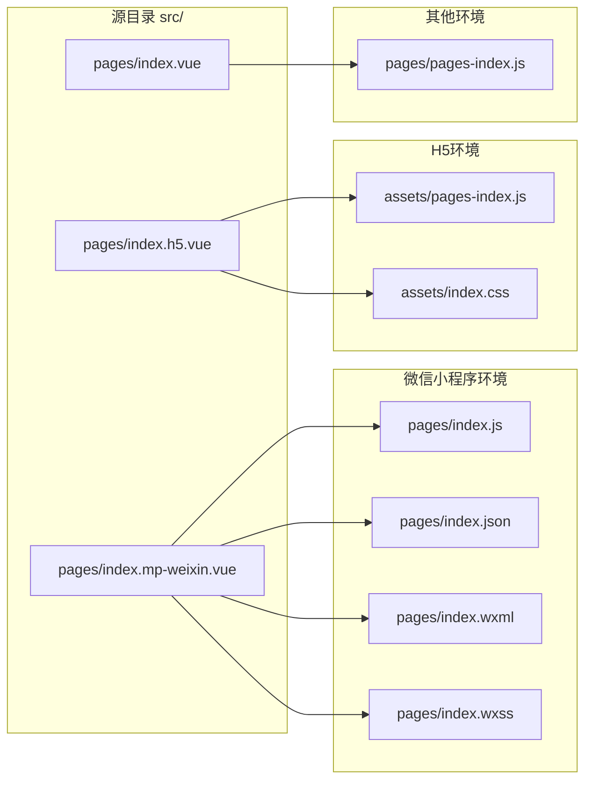

<a href="https://uni-helper.js.org/vite-plugin-uni-platform"></a>

# @uni-helper/vite-plugin-uni-platform

<p align="center">
  
</p>

<p align="center">
  <a href="https://github.com/uni-helper/vite-plugin-uni-platform/blob/main/LICENSE"></a>
  <a href="https://github.com/uni-helper/vite-plugin-uni-platform/stargazers"></a>
  <a href="https://npmx.dev/package/@uni-helper/vite-plugin-uni-platform"></a>
  <a href="https://npmx.dev/package/@uni-helper/vite-plugin-uni-platform"></a>
</p>
<p align="center">
  <a href="https://github.com/kejunmao"></a>
  <a href="https://github.com/ModyQyW"></a>
</p>

基于文件名 (`*.<h5|mp-weixin|app>.*`) 的按平台编译插件

不想看文档？直接问 AI 🤖 <a href="https://deepwiki.com/uni-helper/vite-plugin-uni-platform"></a>

## 安装

```bash
pnpm i -D @uni-helper/vite-plugin-uni-platform
```

## 使用

```ts
import Uni from '@dcloudio/vite-plugin-uni'
import UniPlatform from '@uni-helper/vite-plugin-uni-platform'
// vite.config.ts
import { defineConfig } from 'vite'

export default defineConfig({
  plugins: [
    UniPlatform(),
    Uni()
  ],
})
```

现在所有的带有平台标识符的文件都会被自动替换！


## 其他

<details>

<summary>与 @uni-helper/vite-plugin-uni-pages 插件一起使用</summary>
<br>

自 vite-plugin-uni-pages 0.2.12 起不再需要额外处理，按顺序注册即可：

```ts
import Uni from '@dcloudio/vite-plugin-uni'
import UniPages from '@uni-helper/vite-plugin-uni-pages'
import UniPlatform from '@uni-helper/vite-plugin-uni-platform'
// vite.config.ts
import { defineConfig } from 'vite'

export default defineConfig({
  plugins: [
    UniPlatform(),
    UniPages(),
    Uni(),
  ],
})
```

uni-pages 0.6.1 起在插件列表里按名字 `vite-plugin-uni-platform` 识别本插件，自己过滤其他平台的页面并剥掉当前平台的后缀（`pages/index.h5.vue` 生成为 `/pages/index`）。所以 `UniPlatform()` 要放在 `UniPages()` 前面；插件被改名或包装后 uni-pages 就认不出来，pages.json 里会混进其他平台的页面。

0.6.1 的 `onBeforeWriteFile` 只接收文件路径，网上流传的 `ctx.pageMetaData` 过滤片段在新版本里已经不适用。

</details>

## 参与贡献

欢迎提交 Pull Request，请阅读 [CONTRIBUTING.md](./CONTRIBUTING.md) 了解开发与提交规范。

## 许可证

[MIT](https://github.com/uni-helper/vite-plugin-uni-platform/blob/main/LICENSE)
