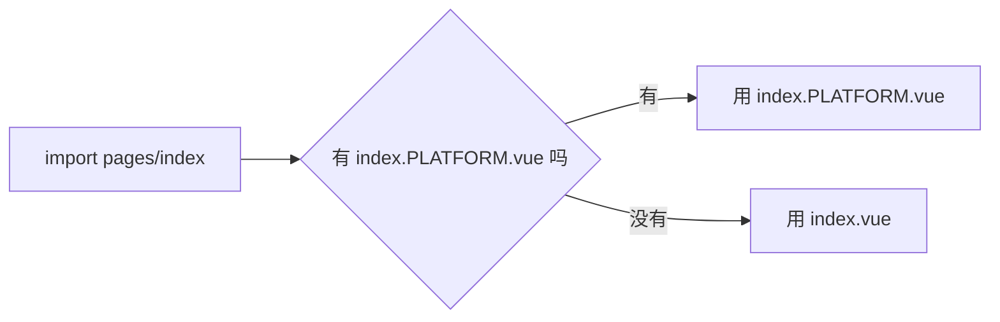

<a href="https://uni-helper.js.org/vite-plugin-uni-platform/"></a>

# @uni-helper/vite-plugin-uni-platform

<p align="center">
  
</p>

<p align="center">
  <a href="https://github.com/uni-helper/vite-plugin-uni-platform/blob/main/LICENSE"></a>
  <a href="https://github.com/uni-helper/vite-plugin-uni-platform/stargazers"></a>
  <a href="https://npmx.dev/package/@uni-helper/vite-plugin-uni-platform"></a>
  <a href="https://npmx.dev/package/@uni-helper/vite-plugin-uni-platform"></a>
</p>

<p align="center">
  <a href="https://github.com/kejunmao"></a>
  <a href="https://github.com/ModyQyW"></a>
</p>

按文件名分流的平台编译插件：`index.h5.vue` 只在 H5 生效，`index.mp-weixin.vue` 只在小程序生效。

不想看文档？直接问 AI 🤖 <a href="https://deepwiki.com/uni-helper/vite-plugin-uni-platform"></a>

> **请考虑持续[赞助](https://github.com/ModyQyW/sponsors)以维持该项目的持续健康发展，非常感谢！🙏**

## 简介

uni-app 项目里想给某个平台单独写一份页面或工具函数，一般得在代码里堆 `#ifdef`。这个插件把分流搬到文件名上：带平台后缀的文件只在对应平台参与构建，其他平台看不到它，源码里也不用写条件判断。

插件只做文件替换，不改写文件内容，所以对 `.vue`、`.ts`、`.scss` 一视同仁。平台的判断依据是 `UNI_CUSTOM_SCRIPT` 或 `UNI_PLATFORM`，自定义编译脚本（比如 `uni -p h5-weixin`）也能用。

## 安装

```bash
pnpm i -D @uni-helper/vite-plugin-uni-platform
```

peer 依赖是 `vite ^5.0.0`。

> [!IMPORTANT]
> 本插件现在只构建 ESM 产物，`exports` 只有 `import` 字段，所以 Vite 配置文件需要按 ESM 加载：命名为 `vite.config.mts`，或者在 `package.json` 里设置 `"type": "module"`。已发布的 0.1.x 同时提供 CJS 和 ESM 入口。
>
> 配置按 ESM 加载后，`@dcloudio/vite-plugin-uni` 的 CJS 默认导出拿到的是模块对象而不是函数，需要换成 [@uni-helper/plugin-uni](https://github.com/uni-helper/plugin-uni) 的 ESM 导出。

## 快速开始

```ts
// vite.config.mts
import Uni from '@uni-helper/plugin-uni'
import UniPlatform from '@uni-helper/vite-plugin-uni-platform'
import { defineConfig } from 'vite'

export default defineConfig({
  plugins: [
    UniPlatform(),
    Uni(),
  ],
})
```

目录里准备两份文件：

```text
src/pages/index.vue           # 所有平台的基础版本
src/pages/index.h5.vue        # 只在 H5 生效，覆盖上面的基础版本
src/pages/index.mp-weixin.vue # 只在微信小程序生效
```

构建 H5 时 `pages/index` 用的是 `index.h5.vue`，构建微信小程序时用的是 `index.mp-weixin.vue`。

## 使用

### 什么样的文件名算平台文件

文件名去掉扩展名后以 `.{platform}` 结尾就算。后缀加在文件名最后一个点之前，目录名里的点不算：

```text
pages/index.h5.vue          # 算，H5 的页面
pages/v1.2/detail.h5.vue    # 算，H5 的页面；v1.2 是目录名
pages/v1.2/detail.vue       # 不算
```

### 基础文件和平台文件

两种文件同时存在时，平台文件覆盖基础文件，文件内容整个换掉。只有平台文件、没有基础文件时也能解析，导入不用写后缀：



```ts
// 磁盘上只有 utils/test.h5.ts 和 utils/test.mp-weixin.ts
import { sum } from '@/utils/test'
```

### 小程序里的 vue 文件

小程序端（`UNI_PLATFORM` 以 `mp-` 开头）的 `.vue` 文件，插件返回平台文件自己的路径，其余情况返回拼接后的解析结果。这样小程序产物按平台文件命名，比如 `pages/index.mp-weixin.wxml`，而不是让 uni 把平台文件当成另一个页面注册进去。

### 与 @uni-helper/vite-plugin-uni-pages 一起使用

`@uni-helper/vite-plugin-uni-pages` 0.6.1 在 `configResolved` 里按插件名 `vite-plugin-uni-platform` 认出本插件，自己过滤掉带其他平台后缀的页面并把后缀剥掉（`pages/index.h5.vue` 生成 `/pages/index`），不需要再写 `onBeforeWriteFile`。

```ts
import Uni from '@uni-helper/plugin-uni'
import UniPages from '@uni-helper/vite-plugin-uni-pages'
import UniPlatform from '@uni-helper/vite-plugin-uni-platform'
import { defineConfig } from 'vite'

export default defineConfig({
  plugins: [
    UniPlatform(),
    UniPages(),
    Uni(),
  ],
})
```

uni-pages 只按插件名识别，所以本插件不能被改名，也不能被别的插件包一层，否则它认不出来，`pages.json` 里会混进其他平台的页面。两者在插件列表里的先后顺序没有要求。

用 uni-pages 的 `prepare()` 提前生成页面配置时，`platformSuffix` 必须和插件列表一致：

```ts
export default defineConfig(async () => ({
  plugins: [
    await UniPages().prepare({ platformSuffix: true }),
    UniPlatform(),
    Uni(),
  ],
}))
```

### 用 TypeScript 检查没有实体文件的导入

`@/utils/test` 在磁盘上没有对应文件，`tsc` 找不到它。给类型检查补一个声明就行，playground 里的 `src/utils/test.d.ts` 就是这么做的：

```ts
export declare const sum: (a: number, b: number) => string
```

## API 参考

### VitePluginUniPlatform(options?)

创建插件实例，具名导出和默认导出都有。插件名是 `vite-plugin-uni-platform`，`enforce: 'pre'`。

| 选项 | 类型 | 默认值 | 说明 |
| --- | --- | --- | --- |
| `include` | `FilterPattern` | `'**/*'` | 参与替换的文件，交给 Vite 的 `createFilter` |
| `exclude` | `FilterPattern` | `[/[\\/]node_modules[\\/]/, /[\\/]\.git[\\/]/]` | 跳过的文件，同样是 `createFilter` 规则 |

```ts
UniPlatform({
  include: 'src/**/*',
  exclude: [/[\\/]node_modules[\\/]/, /[\\/]dist[\\/]/],
})
```

`resolveId` 先看导入本身是否已带当前平台后缀（带就直接放行），再走默认解析；默认解析失败时才把平台名插进文件名重试，解析结果要过 `include` / `exclude`。`load` 对不带后缀的 id 拼出 `{name}.{platform}{ext}`，文件存在就返回它的内容。

## 参与贡献

欢迎提交 Pull Request，请阅读 [CONTRIBUTING.md](./CONTRIBUTING.md) 了解开发与提交规范。

## 许可证

[MIT](https://github.com/uni-helper/vite-plugin-uni-platform/blob/main/LICENSE)
